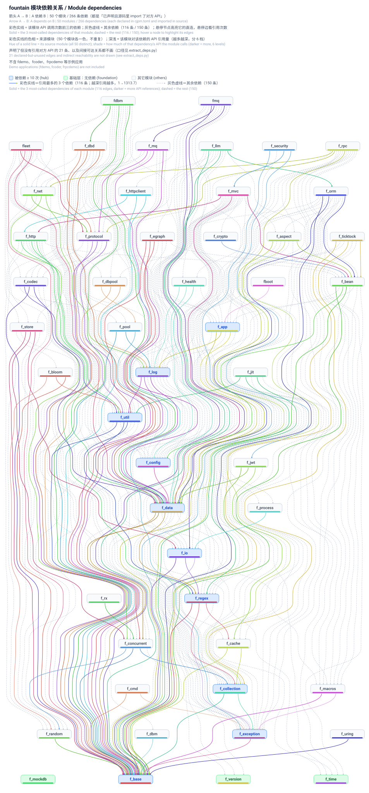
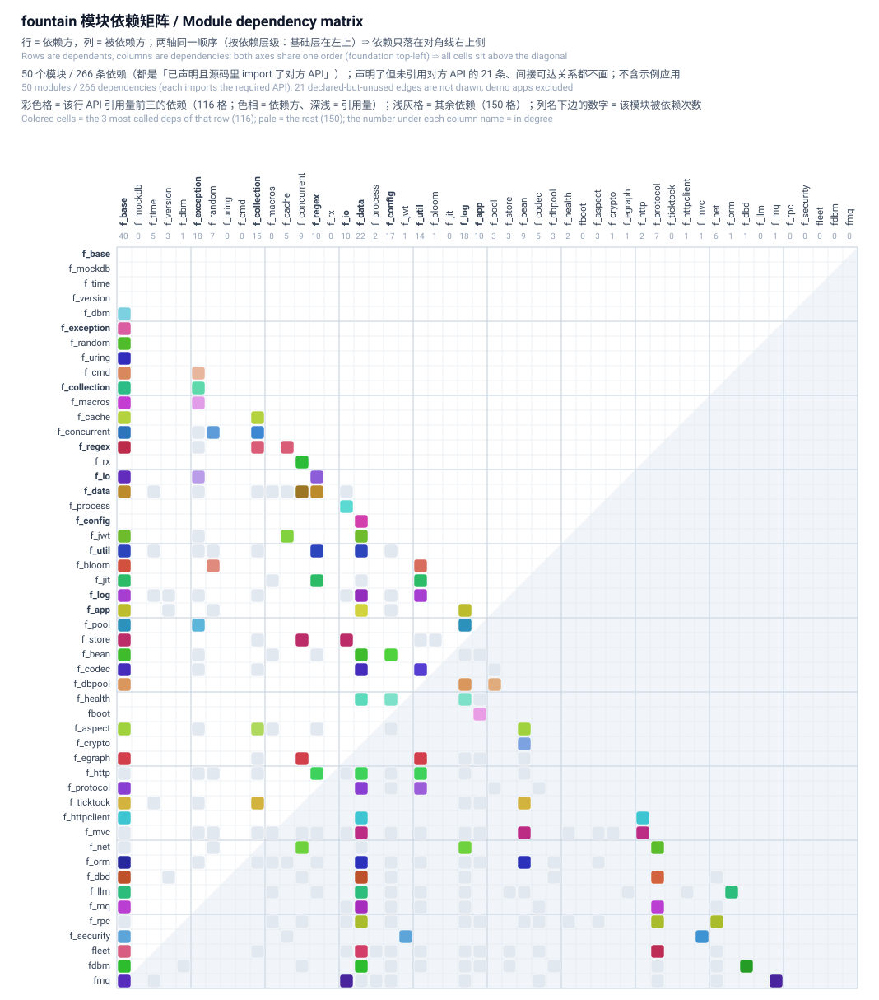

```
  _____                    __         .__
_/ ____\____  __ __  _____/  |______  |__| ____
\   __\/  _ \|  |  \/    \   __\__  \ |  |/    \
 |  | (  <_> )  |  /   |  \  |  / __ \|  |   |  \
 |__|  \____/|____/|___|  /__| (____  /__|___|  /
                        \/          \/        \/
```


# fountain

## 介绍

## Stargazers over time


## 运行视频

> 🎥 [查看完整演示视频](https://www.bilibili.com/video/BV1rtpT62Eaz/?vd_source=29618d9ddd46963c9eabd64d9e362fb4)

## STDX依赖
配置环境变量：`export CANGJIE_STDX_DYNAMIC_PATH=/path/to/dynamic_stdx`

## `fountain::fboot`
依赖fountain的应用项目启动程序，应用项目只需要编译为动态链接库，fboot会调用`fountain::f_app`完成应用启动。

**详情请见：**<https://gitcode.com/Cangjie-TPC/fountain/blob/master/fboot/README.md>

### 安装
```bash
cjpm install fountain::fboot-a.b.c --root /path/to/install # 把a.b.c换成具体的版本号
export PATH=$PATH:/path/to/install/bin
export LD_LIBRARY_PATH=$LD_LIBRARY_PATH:/path/to/install/libs/fboot
```
### 启动
```bash
fboot run --dylibPattern=<REGEX_OF_PROJECT_DYLIB_FILENAMES> # 具体查看项目的fdemo模块的boot.sh脚本
# dylibPattern也可以定义为环境变量，eg.
# export dylibPattern=<REGEX_OF_PROJECT_DYLIB_FILENAMES>
```
### 创建项目与添加依赖
安装`fboot`之后，可以执行`fboot workspace`将当前目录初始化为仓颉workspace项目，详细见`fboot`文档。
项目需要的任何模块都在项目根目录的cjpm.toml添加。以`f_base`为例：
```bash
fboot workspace <workspace_name> # 省略<workspace_name>，就是以当前工作路径创建workspace，此时工作路径必须是空的
# 自动添加版本号为1.0.0和fountain::f_base fountain::f_version的依赖
# 自动添加的依赖与fboot版本一致
# 自动添加stdx依赖，请自行定义环境变量CAGNJIE_STDX_DYNAMIC_PATH
cd <workspace_name>
fboot module <module_name> # 创建动态链接库模块
fboot help # 显示fboot的其他功能
```
```toml
[dependencies]
# 把a.b.c与`fboot version`相同
"fountain::f_base" = "a.b.c" 
"fountain::f_version" = "a.b.c"
```

## 模块依赖关系

下图是 fountain 各模块之间的依赖关系（箭头 `A → B` 表示 A 依赖 B；基础层为不依赖任何模块的模块，蓝框为被依赖次数最多的模块；只画「`cjpm.toml` 声明了、且源码里真的 import 了对方 API」的依赖，每个模块**调用次数前三**的依赖画彩色实线、其余依赖画灰色虚线；图中不含 `fdemo`、`fcoder`、`frpcdemo` 等示例应用）：



下面这张矩阵图是同一份数据的另一种读法，适合按模块查「它依赖了谁 / 谁依赖了它」（行 = 依赖方，列 = 被依赖方，两轴按同一顺序排列，格子颜色 = 依赖方的颜色、深浅 = 该模块对该依赖的 API 调用次数；每行调用次数前三的依赖为彩色格，其余为浅灰格）：



依赖图的生成脚本与重画方式见 [`docs/模块依赖图`](docs/模块依赖图/README.md)。

## `fountain-developer`

`skills/fountain-developer` 是面向 AI 编程智能体的技能（标准 Agent Skills 布局，不绑定特定工具），把「用 fountain 做项目」的完整流程固化下来，覆盖从起步到交付的十一类工作流：

- **起步**：安装 `fboot`、初始化 workspace、用 `fboot module` 创建模块、为项目添加中心仓模块依赖；
- **问答**：回答关于 fountain 配置项与 API 用法的提问（答案标注出处，查不到会直说）；
- **开发**：按需求文档开发服务器应用（MVC / ORM / Bean / AOP / 认证 / 定时任务等）；把其他语言（Python / Java / Go / Node 等）的项目转换为仓颉项目；把非 fountain 的仓颉项目改造为 fountain 风格；在框架仓库内开发框架自身（加功能 / 修缺陷 / 新建模块）；
- **演进**：随功能演进为现有项目增改模块依赖与配置（三个平台脚本同步更新）；
- **交付**：开发类工作流按完整交付流程推进——初始化 → 配置 → 严格 TDD（Red-Green-Refactor，开工先加载 `test-driven-development` 技能）→ 回归测试 + 冒烟测试 → 提交 → 建 tag。

技能的 API 依据**始终来自本仓库的代码与 README**：内置的 `scripts/fountain_lookup.py` 会定位本仓库并提供模块清单、关键词检索（同时覆盖 README 与源码）与模块公开声明清单；本机没有本仓库源码时会自动克隆一份文档副本（仅用于查询）。遇到 fountain 尚未覆盖的能力时，技能会先与开发者确认方案（简化实现 / 提供第三方依赖 / 缩减范围 / 项目内自行实现）再继续，不会硬编假实现。它还会联动仓颉知识库技能（`cangjie-coding` / `cangjie-doc-lookup`）查证语法与 std/stdx API，并在创建项目时参考 `fdemo` / `frpcdemo` 生成三平台启动脚本（`boot.sh` / `boot-macos.sh` / `boot-win-gitbash.sh`）。按需求文档开发服务器应用（工作流 F）与在框架仓库内新建模块（工作流 J）还会走 OpenSpec 规格驱动流程：`opsx:propose` 生成变更五件套 → 开发者评审 `design.md` / `tasks.md` → `opsx:apply` 按任务 TDD 编码 → `opsx:verify` 校验 → `opsx:archive` 归档（规划阶段只出文档、不改代码；OpenSpec 的产物不替代 TDD / 回归 / 冒烟 / 提交 / 建 tag）。

使用方式：把 `skills/fountain-developer` 放进你所用编程智能体的技能目录（如 CodeBuddy 的 `~/.codebuddy/skills/`、Claude Code 的 `~/.claude/skills/`，或项目内的技能目录）；不支持技能机制的智能体，直接让它阅读 `skills/fountain-developer/SKILL.md` 即可。

## 各模块详细文档
### `fountain::f_app`
应用进程管理模块，可以用本模块加载使用fountain开发的应用项目动态链接库。
也可以使用`fountain::fountain.app`包使用本模块的同名API。

**详情请见：**<https://gitcode.com/Cangjie-TPC/fountain/blob/master/f_app/README.md>

### `fountain::f_aspect`
AOP
也可以使用`fountain::fountain.aspect`包使用本模块的同名API。

**详情请见：**<https://gitcode.com/Cangjie-TPC/fountain/blob/master/f_aspect/README.md>

### `fountain::f_base`
一些Iterator扩展，enum OS, 不需要使用unsafe就能获得字符串原始字节数组的字符串扩展, 不需要使用unsafe就能得到ArrayList原始数组的ArrayList扩展, extend Option, extend Array, extend Range, extend Number, extend String, extend ThreadLocal, HashBuilder, StringGenerator，etc.
也可以使用`fountain::fountain.base`包使用本模块的同名API。

**详情请见：**<https://gitcode.com/Cangjie-TPC/fountain/blob/master/f_base/README.md>

### `fountain::f_bean`
IOC
也可以使用`fountain::fountain.base`包使用本模块的同名API。

**详情请见：**<https://gitcode.com/Cangjie-TPC/fountain/blob/master/f_bean/README.md>

### `fountain::f_cache`
堆缓存
也可以使用`fountain::fountain.cache`包使用本模块的同名API。

**详情请见：**<https://gitcode.com/Cangjie-TPC/fountain/blob/master/f_cache/README.md>

### `fountain::f_cmd`
命令行工具
也可以使用`fountain::fountain.cmd`包使用本模块的同名API。

**详情请见：**<https://gitcode.com/Cangjie-TPC/fountain/blob/master/f_cmd/README.md>

### `fountain::f_codec`
编解码器

**详情请见：**<https://gitcode.com/Cangjie-TPC/fountain/blob/master/f_codec/README.md>

### `fountain::f_collection`
标准库尚不支持的集合以及一些标准库集合扩展
也可以使用`fountain::fountain.collection`包使用本模块的同名API。

**详情请见：**<https://gitcode.com/Cangjie-TPC/fountain/blob/master/f_collection/README.md>

### `fountain::f_concurrent`
负载均衡、限流算法、标准库尚不支持的并发集合和标准库并发集合扩展
也可以使用`fountain::fountain.concurrent`包使用本模块的同名API。

**详情请见：**<https://gitcode.com/Cangjie-TPC/fountain/blob/master/f_concurrent/README.md>

### `fountain::f_config`
配置模块
也可以使用`fountain::fountain.config`包使用本模块的同名API。

**详情请见：**<https://gitcode.com/Cangjie-TPC/fountain/blob/master/f_config/README.md>

### `fountain::f_crypto`
加密模块
也可以使用`fountain::fountain.crypto`包使用本模块的同名API。

**详情请见：**<https://gitcode.com/Cangjie-TPC/fountain/blob/master/f_crypto/README.md>

### `fountain::f_data`
数据复制模块，可以实现任意类实例之间同名公共成员变量、公共成员属性之间的复制。
可以随时得到指定名称的公共成员变量或属性的的值。
有各种数据验证注解，这些注解可以修饰公共成员变量或属性，也可以修饰函数参数，实现了复制时数据验证，MVC传参时也可以验证controller函数实参。
也可以使用`fountain::fountain.data`包使用本模块的同名API。

**详情请见：**<https://gitcode.com/Cangjie-TPC/fountain/blob/master/f_data/README.md>

### `fountain::f_dbpool`
数据库连接池，基于f_pool实现Datasource连接池（`DatabasePool` 从 f_orm 迁出，由 f_orm 重导出）

**详情请见：**<https://gitcode.com/Cangjie-TPC/fountain/blob/master/f_dbpool/README.md>

### `fountain::f_exception`
异常模块
也可以使用`fountain::fountain.exception`包使用本模块的同名API。

**详情请见：**<https://gitcode.com/Cangjie-TPC/fountain/blob/master/f_exception/README.md>

### `fountain::f_http`
HTTP，目前实现了HTTP数据格式MediaType的定义和json、multipart/form-data的实现。
也可以使用`fountain::fountain.http`包使用本模块的同名API。

**详情请见：**<https://gitcode.com/Cangjie-TPC/fountain/blob/master/f_http/README.md>

### `fountain::f_httpclient`
HTTP客户端
也可以使用`fountain::fountain.httpclient`包使用本模块的同名API。

**详情请见：**<https://gitcode.com/Cangjie-TPC/fountain/blob/master/f_httpclient/README.md>

### `fountain::f_io`
IO
也可以使用`fountain::fountain.io`包使用本模块的同名API。

**详情请见：**<https://gitcode.com/Cangjie-TPC/fountain/blob/master/f_io/README.md>

### `fountain::f_jwt`
JWT
也可以使用`fountain::fountain.jwt`包使用本模块的同名API。

**详情请见：**<https://gitcode.com/Cangjie-TPC/fountain/blob/master/f_jwt/README.md>

### `fountain::f_log`
日志
也可以使用`fountain::fountain.log`包使用本模块的同名API。

**详情请见：**<https://gitcode.com/Cangjie-TPC/fountain/blob/master/f_log/README.md>

### `fountain::f_macros`
宏工具API
也可以使用`fountain::fountain.macros`包使用本模块的同名API。

**详情请见：**<https://gitcode.com/Cangjie-TPC/fountain/blob/master/f_macros/README.md>

### `fountain::f_mockdb`
mock database
也可以使用`fountain::fountain.mockdb`包使用本模块的同名API。

**详情请见：**<https://gitcode.com/Cangjie-TPC/fountain/blob/master/f_mockdb/README.md>

### `fountain::f_mvc`
MVC
也可以使用`fountain::fountain.mvc`包使用本模块的同名API。

**详情请见：**<https://gitcode.com/Cangjie-TPC/fountain/blob/master/f_mvc/README.md>

### `fountain::f_net`
事件驱动的网络通讯模块
也可以使用`fountain::fountain.net`包使用本模块的同名API。

**详情请见：**<https://gitcode.com/Cangjie-TPC/fountain/blob/master/f_net/README.md>

### `fountain::f_orm`
ORM
也可以使用`fountain::fountain.orm`包使用本模块的同名API。

**详情请见：**<https://gitcode.com/Cangjie-TPC/fountain/blob/master/f_orm/README.md>

### `fountain::f_pool`
一个池的实现，提供了对象池、数组池、ArrayList池
也可以使用`fountain::fountain.pool`包使用本模块的同名API。

**详情请见：**<https://gitcode.com/Cangjie-TPC/fountain/blob/master/f_pool/README.md>

### `fountain::f_process`
进展扩展模块
也可以使用`fountain::fountain.process`包使用本模块的同名API。

**详情请见：**<https://gitcode.com/Cangjie-TPC/fountain/blob/master/f_process/README.md>

### `fountain::f_protocol`
一个网络通讯协议实现

**详情请见：**<https://gitcode.com/Cangjie-TPC/fountain/blob/master/f_protocol/README.md>

### `fountain::f_random`
随机数扩展, ThreadLocalRandom, 蓄水池算法, 随机字符串
也可以使用`fountain::fountain.random`包使用本模块的同名API。

**详情请见：**<https://gitcode.com/Cangjie-TPC/fountain/blob/master/f_random/README.md>

### `fountain::f_regex`
正则表达式扩展、正则缓存、正则DSL
也可以使用`fountain::fountain.regex`包使用本模块的同名API。

**详情请见：**<https://gitcode.com/Cangjie-TPC/fountain/blob/master/f_regex/README.md>

### `fountain::f_rx`
反应式编程API
也可以使用`fountain::fountain.rx`包使用本模块的同名API。

**详情请见：**<https://gitcode.com/Cangjie-TPC/fountain/blob/master/f_rx/README.md>

### `fountain::f_security`
配合MVC使用的安全模块
也可以使用`fountain::fountain.security`包使用本模块的同名API。

**详情请见：**<https://gitcode.com/Cangjie-TPC/fountain/blob/master/f_security/README.md>

### `fountain::f_ticktock`
CRON定时器模块
也可以使用`fountain::fountain.ticktock`包使用本模块的同名API。

**详情请见：**<https://gitcode.com/Cangjie-TPC/fountain/blob/master/f_ticktock/README.md>

### `fountain::f_time`
标准库的时间API扩展
也可以使用`fountain::fountain.time`包使用本模块的同名API。

**详情请见：**<https://gitcode.com/Cangjie-TPC/fountain/blob/master/f_time/README.md>

### `fountain::f_util`
crc16/密钥交换协议/命名风格转换/常用设计模式/geohash/snowflake/UUID/murmur_hash/路径匹配/文本模板/树结构转换
也可以使用`fountain::fountain.util`包使用本模块的同名API。

**详情请见：**<https://gitcode.com/Cangjie-TPC/fountain/blob/master/f_util/README.md>

### `fountain::f_version`
应用与fountain的版本信息和应用BANNER
也可以使用`fountain::fountain.version`包使用本模块的同名API。

**详情请见：**<https://gitcode.com/Cangjie-TPC/fountain/blob/master/f_version/README.md>

### `fountain::f_email`
邮件客户端：SMTP / POP3 / IMAP4rev1 + MIME 解析与生成，统一 `Email` 门面（发信/列信/读正文/取附件/删信），流式附件、TLS 与凭据脱敏

**详情请见：**<https://gitcode.com/Cangjie-TPC/fountain/blob/master/f_email/README.md>

### `fountain::f_zip`
ZIP 容器读写：ZIP64 双向、流式写入（24 字节 ZIP64 descriptor）、大条目落盘、Zip Slip / 符号链接 / 炸弹防护

**详情请见：**<https://gitcode.com/Cangjie-TPC/fountain/blob/master/f_zip/README.md>

### `fountain::f_egraph`
事件驱动的流程库

**详情请见：**<https://gitcode.com/Cangjie-TPC/fountain/blob/master/f_egraph/README.md>

### `fountain::f_llm`
基于`fountain::f_egraph`的大模型开发库

**详情请见：**<https://gitcode.com/Cangjie-TPC/fountain/blob/master/f_llm/README.md>

### `fountain::f_store`
基于`fountain::f_collection.ConcurrentSkipListMap`和`fountain::f_io.SegmentedLog`的LSM-TREE键值存储。
确保增删改查每一个操作都是原子的。还支持KEY前缀遍历的迭代器。

**详情请见：**<https://gitcode.com/Cangjie-TPC/fountain/blob/master/f_store/README.md>

### `fountain::fleet`
基于`fountain::f_store`、`fountain::f_codec`、`fountain::f_net`、`fountain::f_protocol`的数据同步服务。
可以用于服务注册、配置中心、元数据注册等。

**详情请见：**<https://gitcode.com/Cangjie-TPC/fountain/blob/master/fleet/README.md>

### `fountain::f_rpc`
RPC实现，服务自注册与发现，实现负载均衡、服务节点权重、心跳保活等

**详情请见：**<https://gitcode.com/Cangjie-TPC/fountain/blob/master/f_rpc/README.md>

### `fountain::f_bloom`
布隆过滤器（Bloom Filter）实现

**详情请见：**<https://gitcode.com/Cangjie-TPC/fountain/blob/master/f_bloom/README.md>

### `fountain::f_health`
进程健康检查

**详情请见：**<https://gitcode.com/Cangjie-TPC/fountain/blob/master/f_health/README.md>

### `fountain::f_uring`
liburing 的 FFI 封装，所有 API 仅 Linux 可用

**详情请见：**<https://gitcode.com/Cangjie-TPC/fountain/blob/master/f_uring/README.md>

### `fountain::f_mq`
消息队列客户端与客户端/服务端共用 API：记录编解码、协议载荷、过滤器、主题校验与 `MQClient`。

**详情请见：**<https://gitcode.com/Cangjie-TPC/fountain/blob/master/f_mq/README.md>

### `fountain::fmq`
消息队列服务端（`fmq server` / `fmq manager`）：多节点队列、消费组游标、超时重投与死信、
元数据全量复制与备份副本。

**详情请见：**<https://gitcode.com/Cangjie-TPC/fountain/blob/master/fmq/README.md>

### `fountain::f_dbd`
`std.database.sql` 驱动实现：把 SQL 与参数发给 `fountain::fdbm` 中间件，按需把结果集拉回。
本身不依赖任何物理数据库驱动，注册名由配置项 `dbd_driverName` 指定（多节点形态为 `multidbd`）。

**详情请见：**<https://gitcode.com/Cangjie-TPC/fountain/blob/master/f_dbd/README.md>

### `fountain::f_dbm`
数据库中间件的扩展接口库：分库算法 `PartitionAlgorithm` 与 ID 生成器 `IdGenerator` 的契约。
第三方扩展只需依赖本模块，编译成动态库放进 fdbm 的 `custom/` 目录即可被发现。

**详情请见：**<https://gitcode.com/Cangjie-TPC/fountain/blob/master/f_dbm/README.md>

### `fountain::fdbm`
数据库中间件（可执行模块）：对应用暴露一个逻辑库，对内提供分库路由、读写分离、全局表广播、
ID 生成与分库缓存。应用通过 `fountain::f_dbd` 驱动连接，物理数据库驱动只从部署目录的 `driver/` 加载。

**详情请见：**<https://gitcode.com/Cangjie-TPC/fountain/blob/master/fdbm/README.md>

### `fountain::f_jit`
仓颉方言的字节码编译器与 JIT：把方言源码编译为与架构无关的字节码（`.fbc`），由解释器与
x86_64 / aarch64 机器码后端执行，并以 `JitFunction.call<T>` 与宿主侧类、函数、闭包互通。
语义以解释器为准，机器码仅支持 Linux，其余平台自动走解释器。

**详情请见：**<https://gitcode.com/Cangjie-TPC/fountain/blob/master/f_jit/README.md>

### `fountain::fboot`
依赖fountain的应用项目启动程序

**详情请见：**<https://gitcode.com/Cangjie-TPC/fountain/blob/master/fboot/README.md>